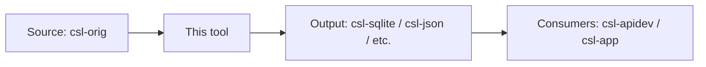
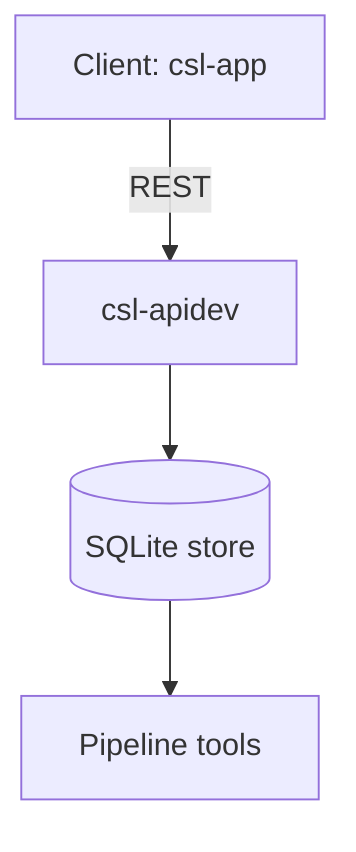

# cologne-tooling-runbook

Use this skill when the user asks to run the migrated source command `cologne-tooling-runbook`.

## Command Template


# /cologne-tooling-runbook

_Created: 03-07-2026 · Last updated: 01-10-2026_

Apply the **Cologne tooling-repo taxonomy** to a non-dictionary repository given in the argument: $ARGUMENTS.

The org is `sanskrit-lexicon`. This runbook is for **infrastructure, tooling, data-pipeline, and frontend repos** — NOT for dictionary digitization repos (those use [`cologne-issue-runbook`](https://github.com/gasyoun/claude-config/blob/main/commands/cologne-issue-runbook.md)).

Execute all phases **without asking for user confirmation** except where marked [ASK]. Complete through commit and push.

---

## Why a separate runbook?

Dictionary repos (PWG, MW, AP90, …) all do the same job: digitize a printed source and host corrections to its XML. Their issues fall into nine narrow buckets (link-target, scan-quality, encoding, …) and four milestones map cleanly onto print → digital → structured-data → enhancement.

**Tool repos are heterogeneous.** A REST API (`csl-apidev`), a SLP1→Devanagari converter (`csl-devanagari`), a flutter app (`csl-app`), an XML data store (`csl-orig`), and a build script (`cologne-stardict`) share almost nothing operationally. Forcing them into the dictionary taxonomy creates noise: a "wrong API endpoint" issue is not a "text-correction"; a "rebuild Hugo site" issue is not "scan-quality".

This runbook gives them their own taxonomy: **software-engineering categories** (bug, feature, perf, dep, infra) crossed with a **domain category** (web-frontend, data-pipeline, converter, …) so that triage across many heterogeneous repos remains tractable.

---

## Autonomy Rules

- Execute all steps without confirmation unless marked [ASK].
- Batch all [ASK] items; ask at most once per session.
- All `gh` API calls, file edits, git commits, and pushes may be executed freely.
- Retry once on transient 5xx/timeouts before continuing.
- **Windows encoding**: Python scripts must include `sys.stdout.reconfigure(encoding='utf-8')` and `sys.stderr.reconfigure(encoding='utf-8')`; pass `encoding='utf-8'` to `subprocess.run`.
- **Background execution**: for batches of 20+ API calls, write to a `.py` file, run in background, monitor with `until grep -q "DONE\|ERRORS" log; do sleep 10; done`.
- **Discover, don't hardcode**: milestone numbers and project IDs vary per repo — fetch via API and build a title-keyed map.
- After labeling completes, wait for log confirmation before running project assignment (race condition risk).

---

## Fetching issues correctly (read first)

Every phase that reads issues — Audit (1), node-ID lookup (6), Verification (7) — must use the **one** correct fetch below. Skipping any of these three pitfalls produces false "done" readings:

1. **Judge per issue, not per repo.** "Processed" means *every* issue has exactly 1 type + 1 severity + 1 milestone (`discussion`-tagged issues are milestone-exempt) — not that those labels merely *exist* in the repo. A label-definition check (`labels | contains(["tech-debt"])`) is always wrong.
2. **Paginate.** REST `…/issues?per_page=100` returns only the first page, so large tool repos (`COLOGNE`, `csl-orig`: 200+ issues) hide everything past issue 100 — including issues that already carry *multiple* type labels. Loop GraphQL `repository.issues(first:100, after:$cur)` on `pageInfo.hasNextPage`.
3. **Exclude PRs.** REST `/issues` includes pull requests (dependabot bumps, docs/Pages-fix PRs). GraphQL's `issues` connection excludes them by construction — so prefer it everywhere.

Canonical fetch — reuse in every phase below (mirrors the org-wide verifier `_verify_clean.py`):

```python
import subprocess, json
ORG = "sanskrit-lexicon"

def gh(a):
    for _ in range(3):
        r = subprocess.run(["gh","api"]+a, capture_output=True, encoding="utf-8")
        if r.returncode == 0: return r
    return r

def fetch_issues(repo):
    """Every issue (open+closed), all pages, PRs excluded."""
    Q = '''query($o:String!,$n:String!,$c:String){repository(owner:$o,name:$n){
      issues(first:100,after:$c,states:[OPEN,CLOSED]){pageInfo{hasNextPage endCursor}
      nodes{number id title comments{totalCount} createdAt
            labels(first:30){nodes{name}} milestone{title number}
            projectItems(first:10){nodes{project{number}}}}}}}'''
    out, cur = [], None
    while True:
        a = ["graphql","-f","query="+Q,"-f","o="+ORG,"-f","n="+repo]
        if cur: a += ["-f","c="+cur]
        d = json.loads(gh(a).stdout)["data"]["repository"]["issues"]
        for x in d["nodes"]:
            out.append({"number":x["number"],"node_id":x["id"],"title":x["title"],
                        "comments":x["comments"]["totalCount"],"created":x["createdAt"],
                        "labels":[l["name"] for l in x["labels"]["nodes"]],
                        "milestone":(x["milestone"] or {}).get("title"),
                        "ms_number":(x["milestone"] or {}).get("number"),
                        "projects":[p["project"]["number"] for p in x["projectItems"]["nodes"]]})
        if d["pageInfo"]["hasNextPage"]: cur = d["pageInfo"]["endCursor"]
        else: break
    return out
```

---

## Phase 0 — Setup

## Phase 1 — Audit

Fetch all issues, labels, milestones:
Fetch all issues with `fetch_issues(REPO)` from *Fetching issues correctly* (above) — paginated and PR-free; each dict carries `number, title, comments, created, labels, milestone, ms_number, projects` for the classification below (derive `age_days` from `created`). **Do not** use `gh api "…/issues?state=all&per_page=100"`: it stops at the first 100 issues and includes pull requests.

Labels and milestones are small (single page) — fetch them with REST:
```sh
gh api repos/$ORG/$REPO/labels --jq '[.[].name]'
gh api repos/$ORG/$REPO/milestones --jq '[.[] | {n:.number, title}]'
```

Classify each issue (read title + first 200 chars of body for context):
- **Triagable now**: clear type from title alone
- **Needs body review**: title ambiguous — fetch body and re-classify
- **Stale**: open 3+ years, no comments, no recent activity → propose `wontfix` or close-as-stale [ASK once with full list]

**Auto-detect noise**: `test`/`admin`/`note` titles; zero labels + zero comments + open 5+ years; tagged `invalid`/`duplicate`. Surface as [ASK] but proceed with the rest in parallel.

---

## Phase 2 — Create labels

The taxonomy has **three orthogonal dimensions**: **type** (what kind of work), **severity** (how big), **domain** (what part of the stack). Every issue must end with exactly one type, exactly one severity. Domain labels are optional but strongly encouraged for cross-repo discoverability.

## Phase 3 — Type label assignment

Every issue gets **exactly one** type label.

### Pre-existing label collision rule

GitHub ships defaults (`bug`, `enhancement`, `question`, `documentation`) that may already be assigned. Our taxonomy uses some of those names but with stricter semantics. Pattern:

1. Check existing labels: `bug`, `enhancement`, `documentation`, `question`
2. If correctly applied (matches the strict semantics below), **keep**
3. If wrong type (e.g., a feature request labeled `bug`), **delete** and reassign
4. Always **delete** legacy `enhancement` if not exactly matching our `enhancement` definition (improvement to existing capability — NOT new features)

```sh
gh api repos/$ORG/$REPO/issues/$N/labels/<old-label> -X DELETE
```

Keep these GitHub defaults: `invalid`, `duplicate`, `wontfix`, `help wanted`, `good first issue`.

## Phase 4 — Severity assignment

Every issue gets **exactly one** severity. Tool repos use a 4-level scale (one more than dictionary repos because tooling has a wider effort range).

| Label | Apply when |
|---|---|
| `trivial` | Cosmetic (typo, whitespace, dead comment), < 1 hour, single-file diff |
| `minor` | Single function/component, well-scoped, no design decision required |
| `major` | Multiple files/modules, requires design decision, affects user-visible behavior |
| `critical` | Blocks users, data loss/corruption risk, security CVE, production outage |

## Phase 5 — Milestone setup

Tool repos use a **5-milestone framework** (one more than dictionary repos to capture the developer-experience axis):

```sh
for title in "API Stability" "User Experience" "Data Quality" "Developer Experience" "Community"; do
  gh api repos/$ORG/$REPO/milestones -X POST -f title="$title" 2>/dev/null || true
done
```

Fetch numbers (do not hardcode):
```sh
gh api repos/$ORG/$REPO/milestones --jq '[.[] | {n:.number, title}]'
```

### Type → milestone mapping

| Milestone | Types |
|---|---|
| **API Stability** | `bug` (in API), `regression`, `dependency`, `security`, `docs-api` |
| **User Experience** | `bug` (user-facing), `feature`, `enhancement`, `performance` |
| **Data Quality** | `bug` (data), `data-pipeline`, all `domain:integrity`/`domain:roundtrip` issues |
| **Developer Experience** | `tech-debt`, `infrastructure`, `build-tooling`, `documentation` |
| **Community** | `question`, `proposal`, `discussion`, `cross-repo` |

For multi-type ambiguity, priority order:
`security` > `regression` > `cross-repo` > `data-pipeline` > `bug` > `feature` > `enhancement` > `performance` > `dependency` > `infrastructure` > `tech-debt` > `build-tooling` > `documentation` > `docs-api` > `proposal` > `question` > `discussion`

---

## Phase 6 — GitHub Projects (org-level)
## Phase 7 — Verification
## Phase 8 — CLAUDE.md

Generate `CLAUDE.md` with sections tailored to the repo category:

- **Project Overview**: what the repo is, its place in the CDSL stack, primary inputs/outputs
- **Architecture table**: top-level directories with one-line purpose
- **Tech stack** (new for tool repos): runtime version, primary frameworks/libraries, build tool
- **Data contracts** (for `data-store`/`converter`/`linking-tool`): input format, output format, invariants
- **Local development**: how to install, run, test
- **Common commands**: build, test, deploy, lint
- **Known limitations**: documented edge cases, deferred work
- **GitHub Issue Conventions**: link to this runbook; list the type/severity/milestone framework

---

## Phase 9 — README.md

Required sections (order matters):
1. Title + one-sentence purpose
2. **Manual blocks (preserve verbatim).** Any region delimited by `<!-- BEGIN MANUAL: … -->` and `<!-- END MANUAL: … -->` in the current README is hand-maintained: copy it into the regenerated README **byte-for-byte, markers included**, and never drop, move, or reflow it. Separately, also preserve an existing `## Documentation` block or any link into the repo's docs directory — `doc/` **or** `docs/`, singular or plural — referenced from `CLAUDE.md`. Before overwriting, grep the current README for `<!-- BEGIN MANUAL`, a `## Documentation` heading, and `doc/`/`docs/` links, and re-emit them verbatim in the new file. **Never drop them.**
3. Status badge row (build, license, language, last commit)
4. Contents (top-level dir table)
5. **Tech stack table**: runtime, framework, db, build tool, deploy target
6. Quick start (3-5 commands to get running locally)
7. **Issue Status table** (live counts, fetched at commit time):
   ```
   | Milestone | Open | Closed | Total |
   ```
8. **Issue Typology** with two Mermaid pie charts: one by type, one by severity
9. **Issue Domains** (if domain labels used): table of domain → count
10. Labels reference (link to runbook)
11. Contributors

**Validate every Mermaid block** before commit:
```sh
gh api markdown -X POST -f text="$(printf '```mermaid\n%s\n```' '<diagram>')" -f mode="markdown"
```
Confirmed valid when response contains `pl-k` spans inside `highlight-source-mermaid`.

---

## Phase 10 — Commit and push

```sh
cd <repo path>
git add README.md CLAUDE.md
git commit -m "docs(runbook): apply tooling-repo taxonomy (types, severities, milestones, domains)

- 17 type labels across 5 categories
- 4-level severity scale
- 5 milestones (API Stability, UX, Data Quality, DevX, Community)
- Domain labels scoped to repo category
- See sanskrit-lexicon/csl-observatory runbook/cologne-tooling-runbook.md

Co-Authored-By: Claude <noreply@anthropic.com>"
git push
```

---

## Phase 11 — Citation

For tool repos, license is **GPL-3.0** (not CC-BY-SA, which is for data). Use cff-version 1.2.0 with `type: software`:

```yaml
cff-version: 1.2.0
type: software
title: <repo name>
message: If you use this software, please cite it.
authors:
  - family-names: <surname>
    given-names: <name>
    orcid: <if available>
license: GPL-3.0
repository-code: https://github.com/sanskrit-lexicon/<repo>
keywords:
  - sanskrit
  - lexicon
  - <repo-category>
```

---

## Phase 12 — Tech-stack reference (replaces "Source bibliography" from dictionary runbook)

Add `## Tech Stack` to README:
```markdown
## Tech Stack

- **Runtime**: <Python 3.11 / Node 20 / PHP 8.2 / etc.>
- **Framework**: <Flask / Express / Laravel / Flutter / etc.>
- **Build**: <pip / npm / composer / make / etc.>
- **Deploy**: <GitHub Pages / Heroku / VPS / etc.>
- **External services**: <PostgreSQL / Redis / MinIO / etc.>
```

---

## Phase 13 — API contract / data schema
## Phase 15 — Pipeline DAG

Mermaid diagram tailored to category:

For `data-pipeline`:


For `web-backend`:


Validate via `gh api markdown` (Phase 9 instructions).

---

## Phase 16 — Community files

Drop the same templated files as dictionary runbook Phase 16, **plus**:

- `.github/PULL_REQUEST_TEMPLATE.md` — tool-repo version asks for: tests run, breaking-change flag, rollback plan
- `.github/ISSUE_TEMPLATE/bug.yml` — fields for repro steps, expected vs actual, environment
- `.github/ISSUE_TEMPLATE/feature.yml` — fields for use case, success criteria, alternatives considered
- `.github/ISSUE_TEMPLATE/proposal.yml` — fields for problem, proposed solution, alternatives, scope
- `.github/CODEOWNERS` (if maintainer set is stable) — auto-assign reviewers

---

## Phase 17 — Cross-repo coordination registry (NEW for tooling)

Tool repos often have issues that span multiple repos (e.g., "schema change in csl-orig requires updates in csl-apidev and csl-app"). The `cross-repo` label is for these.

Create `CROSS_REPO_INDEX.md` in this repo enumerating:
1. Open `cross-repo` issues here and in linked repos
2. Companion issues elsewhere
3. Coordination owner (a single person responsible for keeping the linked issues in sync)

Auto-update via Phase 9 README generation script — fetch all `cross-repo` issues across the org and rebuild the index.

---

## Checklist

- [ ] Phase 0 category detected and recorded
- [ ] All 17 type labels created
- [ ] All 4 severity labels created
- [ ] Domain labels for the category created
- [ ] All issues have exactly one type label (`multi_type == 0`)
- [ ] All issues have exactly one severity label (`multi_sev == 0`)
- [ ] All non-`discussion` issues have a milestone
- [ ] Issues mapped to the appropriate org-level tooling project
- [ ] No stale GitHub-default labels remain unless intentionally kept
- [ ] `CLAUDE.md` includes Tech Stack and Data Contracts sections
- [ ] `README.md` includes live counts, two Mermaid pie charts, validated
- [ ] `CITATION.cff` uses `type: software` with GPL-3.0
- [ ] Pipeline DAG matches actual data flow
- [ ] Pushed to `origin/<default_branch>`

---

## Repo-category quick reference
## References

Detail moved verbatim (read on demand — lives in the rendered skill copy's references/):

- `references/phase0-setup.md` — Phase 0 setup — clone/checkout commands for the target repo
- `references/label-catalog.md` — Label creation catalog — gh api color commands for type/severity/domain labels
- `references/type-semantics.md` — Type label semantics and disambiguation rules
- `references/severity-tables.md` — Severity assignment detail and type→default-severity table
- `references/batch-labeling.md` — Phase 5b batch labeling script
- `references/github-projects.md` — Phase 6 GitHub Projects (org-level) setup
- `references/phase7-verification.md` — Phase 7 verification procedure
- `references/api-and-schemas.md` — API endpoints, data schema, mapping schema, encoding/locale tables
- `references/repo-category-quickref.md` — Repo-category quick reference
